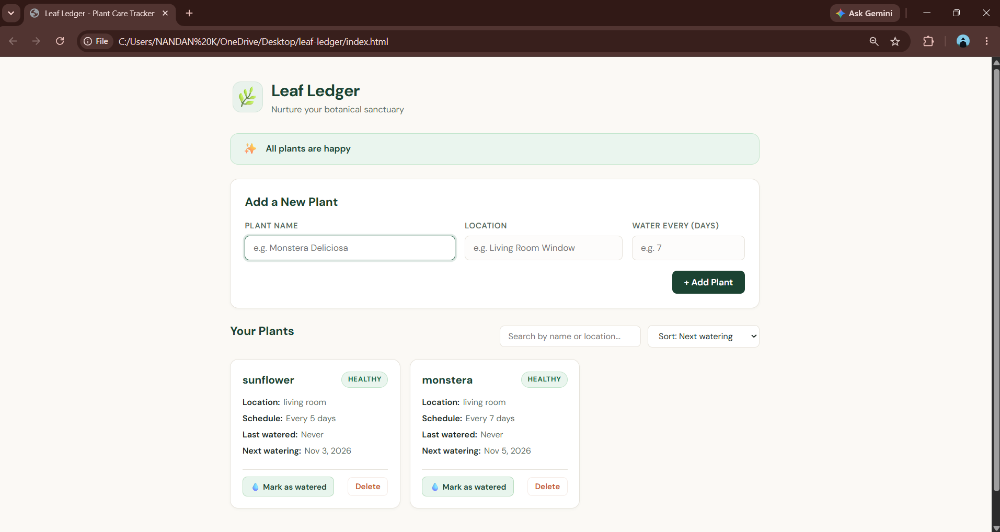

# Leaf Ledger 🌿 — Plant Care Tracker

**Name:** Shravani Patil
**Class:** TY B AIML
**Roll No.:** 56
**Subject:** DevOps and Kubernetes (ISE-II)
**Repository:** https://github.com/patilshravani3687-sudo/leaf-ledger

---

## 1. Introduction and Objective

Leaf Ledger is a lightweight plant care tracker that runs directly in a web browser. It helps plant owners organize their plants, maintain watering schedules, and keep track of which plants need attention.

The website displays plant information, watering schedules, and color-coded status labels. Users can mark plants as watered, search by plant name or location, sort the plant list, and view a daily summary of plants requiring water.

Plant information is stored locally using browser `localStorage`, so the website does not require a database server.

**Objective:**

* Develop a unique and functional website.
* Use Git and GitHub for version control.
* Implement at least five meaningful changes with separate commits.
* Integrate a DevOps tool using Jenkins.
* Maintain project documentation and screenshots in README.md.

---

## 2. Technology Stack

| Part                  | Technology                                         |
| --------------------- | -------------------------------------------------- |
| Frontend              | HTML5, CSS3, vanilla JavaScript                    |
| Storage               | Browser localStorage                               |
| Styling               | CSS variables, Flexbox, CSS Grid                   |
| Version control       | Git, GitHub                                        |
| DevOps tool           | Jenkins with a Declarative Pipeline                |
| JavaScript validation | Node.js, when available in the Jenkins environment |
| Operating system      | Windows                                            |
| Execution             | Web browser                                        |

---

## 3. Project Structure

```text
leaf-ledger/
├── index.html
├── assets/
│   ├── css/
│   │   └── main.css
│   └── js/
│       └── app.js
├── Jenkinsfile
├── README.md
├── 01-dashboard.png
└── screenshots/
```

* `index.html` — Main website structure.
* `assets/css/main.css` — Website styling and layout.
* `assets/js/app.js` — Plant tracking and application logic.
* `Jenkinsfile` — Jenkins pipeline configuration.
* `README.md` — Project documentation and screenshot evidence.
* `01-dashboard.png` — Dashboard screenshot.
* `screenshots/` — Additional project and DevOps evidence.

---

## 4. How to Run the Website

No installation is required to run the website.

### Steps

1. Open the [Leaf Ledger GitHub repository](https://github.com/patilshravani3687-sudo/leaf-ledger).
2. Click **Code → Download ZIP**.
3. Extract the downloaded ZIP file.
4. Open the project folder.
5. Double-click `index.html`.
6. The website opens in your default browser.

Alternatively, clone the repository:

```bash
git clone https://github.com/patilshravani3687-sudo/leaf-ledger.git
```

Open the project directory:

```bash
cd leaf-ledger
```

Then open `index.html` in your browser.

### Features

* Plant tracking and watering schedules.
* Mark-as-watered button with last-watered date.
* Color-coded plant status labels.
* Search plants by name or location.
* Sort plants by watering date, name, or recently added.
* Daily summary banner for plants needing water.
* Local data persistence using browser localStorage.

### Leaf Ledger Website



*Leaf Ledger dashboard screenshot.*

---

## 5. Git and GitHub Workflow

Git and GitHub were used to maintain the project's source code and track development changes.

### 5.1 Initial Setup

Initialize the repository:

```bash
git init
```

Create the main branch:

```bash
git branch -M main
```

Connect the GitHub repository:

```bash
git remote add origin https://github.com/patilshravani3687-sudo/leaf-ledger.git
```

Stage the project files:

```bash
git add .
```

Create the initial commit:

```bash
git commit -m "Add Leaf Ledger v1: plant tracking and watering schedule"
```

Push the project to GitHub:

```bash
git push -u origin main
```

*Note: The initial setup commands are provided for documentation. The existing repository has already been created and pushed.*

### 5.2 Workflow Used for Changes

Each feature was developed incrementally and recorded through Git commits.

Check the current status:

```bash
git status
```

Stage the changes:

```bash
git add .
```

Commit a meaningful change:

```bash
git commit -m "Describe the implemented feature"
```

Push the changes:

```bash
git push
```

View the commit history:

```bash
git log --oneline
```

### 5.3 Commit History

The following commits are present in the repository's reported Git history.

| #             | Commit    | Message                                               |
| ------------- | --------- | ----------------------------------------------------- |
| Initial       | `95f3d1f` | Add Leaf Ledger v1: plant list with watering schedule |
| 1             | `2db5f2f` | Add mark as watered button with last watered date     |
| 2             | `24a2ad2` | Add overdue, due today and healthy status chips       |
| 3             | `759b5ea` | Add plant search by name or location                  |
| 4             | `a5a8b67` | Add sort options for plant list                       |
| 5             | `7d2b0f6` | Add daily summary banner for plants needing water     |
| DevOps        | `d9ac8eb` | Add Jenkinsfile for CI pipeline                       |
| Documentation | `7252d54` | Add README with project documentation                 |

**Total reported commits: 8**

[View Git commit history](https://github.com/patilshravani3687-sudo/leaf-ledger/commits/main)

---

## 6. Changes Made (5 Main Changes)

### Change 1: Mark as Watered

**Commit:** `2db5f2f`

Added a button that allows users to record when a plant has been watered.

When the button is clicked, the application updates the last-watered date and recalculates the next watering date.

### Change 2: Plant Status Indicators

**Commit:** `24a2ad2`

Added color-coded status labels to make plant care easier to manage.

* **Overdue:** The watering date has passed.
* **Due Today:** The plant is due for watering today.
* **Healthy:** The plant is not currently due for watering.

These labels help users quickly identify plants requiring attention.

### Change 3: Plant Search

**Commit:** `759b5ea`

Added an interactive search feature that filters plants by name or location.

The search updates the displayed plant list as the user types and supports case-insensitive matching.

### Change 4: Sorting Options

**Commit:** `a5a8b67`

Added sorting options for the plant list.

Users can sort plants by:

* Next watering date.
* Name in alphabetical order.
* Recently added plants.

Sorting also works with the active search filter.

### Change 5: Daily Summary Banner

**Commit:** `7d2b0f6`

Added a summary banner showing the number of plants requiring watering.

The banner updates according to the current plant statuses and helps users understand their daily plant care requirements.

---

## 7. DevOps Tool Integration: Jenkins

Jenkins is used to automate project validation and packaging through a Declarative Pipeline.

The pipeline configuration is stored in the root directory of the repository in a file named `Jenkinsfile`.

### 7.1 Jenkins Setup

Jenkins can be configured on a local Windows machine and accessed through:

`http://localhost:8080`

The Git and Pipeline plugins are required for the described pipeline setup.

### 7.2 Jenkinsfile

The `Jenkinsfile` defines the automation stages used to validate and package the Leaf Ledger website.

| Stage             | What it does                                                          |
| ----------------- | --------------------------------------------------------------------- |
| Checkout          | Retrieves the project source code from the configured Git repository. |
| Verify Files      | Checks whether essential HTML, CSS, and JavaScript files exist.       |
| Check JavaScript  | Runs a JavaScript syntax check when Node.js is available.             |
| Package           | Creates a ZIP archive containing the website files.                   |
| Archive Artifacts | Stores the generated ZIP archive as a Jenkins build artifact.         |

### 7.3 Create the Jenkins Job

1. Open the Jenkins dashboard.

2. Click **New Item**.

3. Enter the job name `leaf-ledger-pipeline`.

4. Select **Pipeline** and click **OK**.

5. Under the Pipeline section, choose **Pipeline script from SCM**.

6. Select **Git** as the source control management system.

7. Enter the repository URL:

   `https://github.com/patilshravani3687-sudo/leaf-ledger.git`

8. Set the branch specifier to `*/main`.

9. Set the script path to `Jenkinsfile`.

10. Save the configuration.

### 7.4 Run the Pipeline

1. Open the Leaf Ledger Jenkins job.
2. Click **Build Now**.
3. Open the build details.
4. Check the pipeline stages and console output.
5. Verify whether the build completed successfully.
6. If the pipeline creates an archive, check the build artifacts.

### 7.5 Evidence of Jenkins Integration

Add your own screenshots showing:

* Jenkins job configuration.
* The Leaf Ledger pipeline stages.
* Actual build results and console output.
* The archived ZIP artifact, if generated.

**Important:** The presence of a `Jenkinsfile` confirms that pipeline configuration exists, but a successful build must be verified in Jenkins before claiming successful execution.

---

## 8. Screenshots and Project Evidence

Screenshots are included to demonstrate the website, development progress, GitHub repository, and DevOps integration.

### 8.1 Leaf Ledger Dashboard


*The Leaf Ledger dashboard running in a browser.*

### 8.2 Plant Tracking

Add a screenshot showing plant cards and their watering schedules.

### 8.3 Plant Status Indicators

Add a screenshot showing the Overdue, Due Today, and Healthy status labels.

### 8.4 Search and Sorting

Add a screenshot demonstrating the search field and sorting options.

### 8.5 GitHub Repository

Add a screenshot of the repository overview showing the project files and folder structure.

### 8.6 Git Commit History

Add a screenshot showing the Git commit history and meaningful changes.

### 8.7 Jenkins Pipeline

Add a screenshot of the actual Leaf Ledger Jenkins pipeline and its build results.

**Note:** Only the dashboard screenshot is currently linked in this section. Upload the remaining screenshots to GitHub and add their image links before submitting the project.

---

## 9. Conclusion

Leaf Ledger demonstrates the development of a plant care tracking website using HTML, CSS, and JavaScript.

The project includes plant management, watering schedules, status indicators, searching, sorting, and local data persistence.

Git and GitHub provide version control and a history of incremental development changes. Jenkins provides a pipeline configuration for automated project validation and packaging.

The project combines website development, version control, DevOps automation, and technical documentation in a single application.

**Repository:** https://github.com/patilshravani3687-sudo/leaf-ledger
