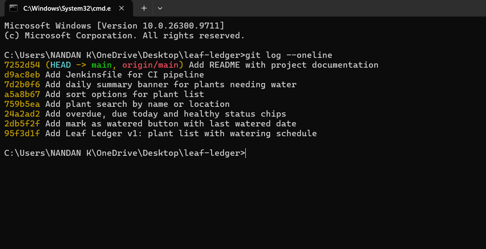
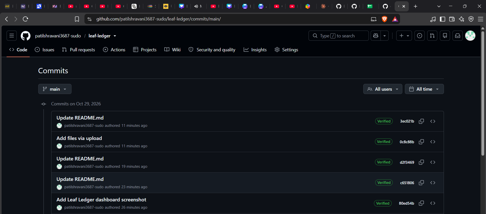
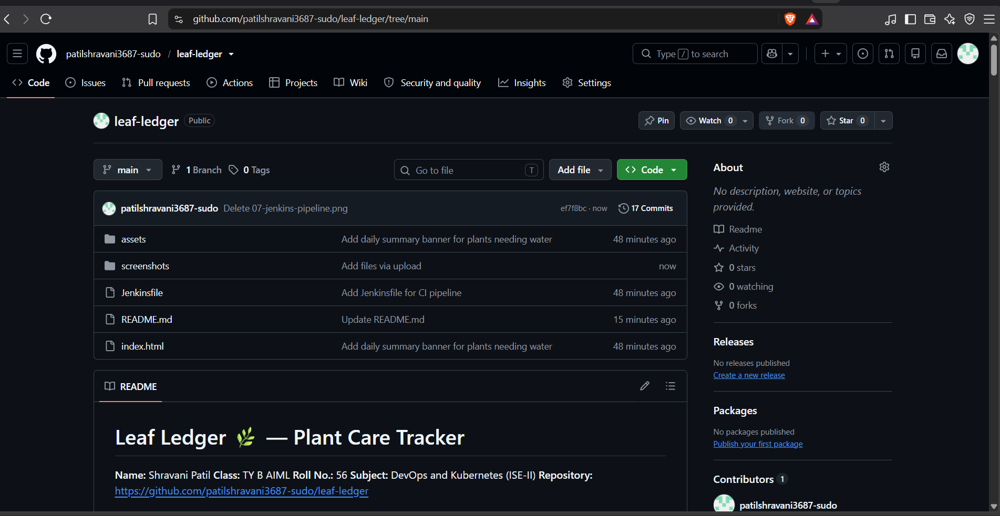
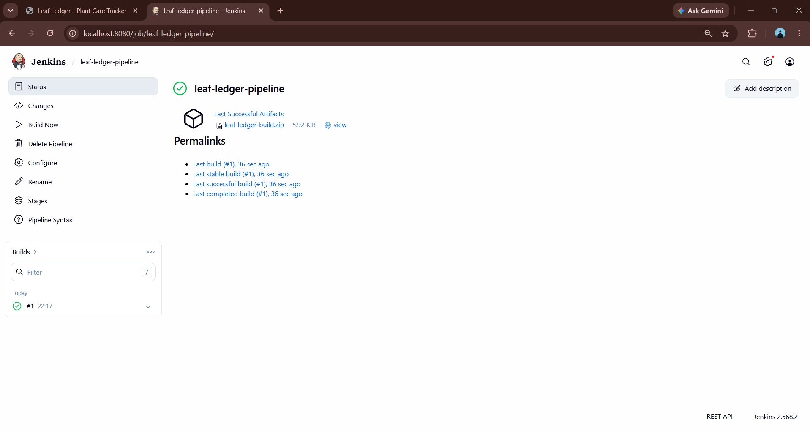

# Leaf Ledger 🌿 — Plant Care Tracker

A clean, minimalist, and dependable plant care tracker that helps users manage their plants, maintain watering schedules, and keep their indoor greenery healthy.

**Student Name:** Shravani Patil
**Class:** TY B AIML
**Roll No.:** 56
**Institution:** D. Y. Patil College of Engineering & Technology, Kolhapur
**Subject:** DevOps and Kubernetes (ISE-II)
**Repository:** [Leaf Ledger on GitHub](https://github.com/patilshravani3687-sudo/leaf-ledger)

---

## 1. Introduction and Objective

Leaf Ledger is a lightweight plant care tracking website built using HTML, CSS, and JavaScript. It helps plant owners organize their plants, monitor watering schedules, and identify which plants require attention.

The website provides plant information, watering status indicators, search and sorting options, and a daily summary of plants that need watering.

Plant data is stored locally in the browser using `localStorage`, allowing users to retain their information between visits without requiring a database server.

### Objectives

* Develop a functional and user-friendly website.
* Implement useful features through incremental development.
* Use Git and GitHub for version control.
* Maintain a meaningful commit history.
* Integrate Jenkins for automated project validation and packaging.
* Document the application and DevOps integration with screenshots.

---

## 2. Technology Stack

| Component             | Technology                   |
| --------------------- | ---------------------------- |
| Frontend              | HTML5                        |
| Styling               | CSS3                         |
| Application logic     | Vanilla JavaScript           |
| Data storage          | Browser localStorage         |
| Version control       | Git                          |
| Source code hosting   | GitHub                       |
| DevOps tool           | Jenkins                      |
| Automation            | Declarative Jenkins Pipeline |
| JavaScript validation | Node.js, when available      |
| Operating system      | Windows                      |
| Execution environment | Web browser                  |

---

## 3. Project Structure

```text
leaf-ledger/
├── assets/
│   ├── css/
│   │   └── main.css
│   └── js/
│       └── app.js
├── screenshots/
│   ├── 01-dashboard.png
│   ├── git_history.png
│   ├── github_commits.png
│   ├── repo_overview.png
│   └── 07-jenkins-pipeline.png
├── Jenkinsfile
├── README.md
└── index.html
```

### File Description

* **index.html:** Contains the website structure.
* **assets/css/main.css:** Defines the visual design, layout, and styling.
* **assets/js/app.js:** Implements plant tracking and application functionality.
* **Jenkinsfile:** Defines the Jenkins automation pipeline.
* **README.md:** Documents the project, development workflow, and DevOps integration.
* **screenshots/:** Contains screenshots demonstrating the website, Git history, GitHub repository, and Jenkins pipeline.

---

## 4. How to Run the Website

Leaf Ledger does not require a build process or package installation.

### Steps

1. Open the [Leaf Ledger GitHub repository](https://github.com/patilshravani3687-sudo/leaf-ledger).
2. Click **Code → Download ZIP**.
3. Extract the downloaded archive.
4. Open the extracted project folder.
5. Double-click `index.html`.
6. The website opens in your default browser.

Alternatively, clone the repository using Git:

```bash
git clone https://github.com/patilshravani3687-sudo/leaf-ledger.git
```

Open the project folder and launch `index.html` in your browser.

**Data storage:** Plant information is saved in the browser's localStorage. Data remains available in the same browser unless it is cleared or the application storage is otherwise reset.

---

## 5. Features and Functionality

### 5.1 Plant Tracking

The application provides a plant tracking interface where users can organize plant information and monitor watering schedules.

### 5.2 Mark as Watered

Users can mark a plant as watered. The application records the watering date and updates its watering schedule.

### 5.3 Plant Status Indicators

Color-coded labels help users understand the watering status of each plant.

* **Overdue:** The plant's watering date has passed.
* **Due Today:** The plant needs watering today.
* **Healthy:** The plant is not currently due for watering.

### 5.4 Search Plants

The search feature filters plants by plant name or location, making it easier to find specific entries.

### 5.5 Sorting Options

Users can organize the plant list using available sorting options:

* Next watering date.
* Name in alphabetical order.
* Recently added plants.

### 5.6 Daily Summary

A summary banner displays information about plants that need watering, helping users identify daily plant care tasks quickly.

### 5.7 Local Data Persistence

The application uses browser localStorage to retain plant information between visits without requiring a remote database.

---

## 6. Git and GitHub Workflow

Git and GitHub were used to track project development and maintain a history of changes.

### 6.1 Repository

**GitHub repository:**
https://github.com/patilshravani3687-sudo/leaf-ledger

### 6.2 Basic Git Workflow

The following commands demonstrate the workflow used to manage project changes.

Check the working tree:

```bash
git status
```

Stage modified files:

```bash
git add .
```

Commit a meaningful change:

```bash
git commit -m "Describe the implemented feature"
```

Push changes to GitHub:

```bash
git push
```

View the commit history:

```bash
git log --oneline
```

### 6.3 Main Development Commits

The following eight commits represent the original project development and documentation history.

| No.     | Commit ID | Change                                                |
| ------- | --------- | ----------------------------------------------------- |
| Initial | `95f3d1f` | Add Leaf Ledger v1: plant list with watering schedule |
| 1       | `2db5f2f` | Add mark as watered button with last watered date     |
| 2       | `24a2ad2` | Add overdue, due today and healthy status chips       |
| 3       | `759b5ea` | Add plant search by name or location                  |
| 4       | `a5a8b67` | Add sort options for plant list                       |
| 5       | `7d2b0f6` | Add daily summary banner for plants needing water     |
| 6       | `d9ac8eb` | Add Jenkinsfile for CI pipeline                       |
| 7       | `7252d54` | Add README with project documentation                 |

Additional commits were created for screenshot uploads and README updates.

**View the complete history:** [Leaf Ledger commits on GitHub](https://github.com/patilshravani3687-sudo/leaf-ledger/commits/main/)

### 6.4 Incremental Development

The application was improved through separate changes rather than being developed in a single commit.

The changes added watering tracking, status indicators, search, sorting, and a daily summary. Jenkins integration and project documentation were added as separate changes.

This workflow demonstrates how Git records development progress and allows changes to be inspected through commit history.

---

## 7. DevOps Tool Integration: Jenkins

Jenkins is used to automate validation and packaging of the Leaf Ledger website through a Declarative Pipeline.

The pipeline configuration is stored in the `Jenkinsfile` at the root of the repository.

### 7.1 Jenkins Environment

* **DevOps tool:** Jenkins
* **Version:** 2.568.2
* **Operating system:** Windows
* **Job name:** `leaf-ledger-pipeline`
* **Source control:** GitHub
* **Branch:** `main`
* **Pipeline definition:** Pipeline script from SCM

Jenkins was accessed locally through:

```text
http://localhost:8080
```

### 7.2 Pipeline Configuration

The Jenkins job uses the following settings:

| Setting          | Value                                                       |
| ---------------- | ----------------------------------------------------------- |
| Job name         | `leaf-ledger-pipeline`                                      |
| Definition       | Pipeline script from SCM                                    |
| SCM              | Git                                                         |
| Repository URL   | `https://github.com/patilshravani3687-sudo/leaf-ledger.git` |
| Branch specifier | `*/main`                                                    |
| Script path      | `Jenkinsfile`                                               |

### 7.3 Pipeline Stages

| Stage             | Purpose                                                       |
| ----------------- | ------------------------------------------------------------- |
| Checkout          | Retrieves the project source code from GitHub.                |
| Verify Files      | Checks that essential project files are present.              |
| Check JavaScript  | Performs a JavaScript syntax check when Node.js is available. |
| Package           | Creates a ZIP archive of the website files.                   |
| Archive Artifacts | Stores the generated ZIP file as a Jenkins build artifact.    |

### 7.4 Running the Pipeline

The pipeline was executed through the Jenkins interface.

1. Open the Jenkins dashboard.
2. Open the `leaf-ledger-pipeline` job.
3. Click **Build Now**.
4. Wait for the build to complete.
5. Inspect the build status and pipeline stages.
6. Verify the generated artifact, if available.

### 7.5 Build Result

The first Leaf Ledger Jenkins build completed successfully.

The Jenkins job displayed a successful build status and generated the following archived artifact:

```text
leaf-ledger-build.zip
```

The artifact contains the packaged website files produced by the pipeline.

This demonstrates the use of Jenkins for automated project validation and packaging.

---

## 8. Screenshots and Project Evidence

The following screenshots provide evidence of the website, version control workflow, GitHub repository, and Jenkins integration.

### 8.1 Website Dashboard


*Leaf Ledger website interface.*

### 8.2 Git History



*Git commit history showing incremental development changes.*

### 8.3 GitHub Commit History



*GitHub page displaying the project's commit history.*

### 8.4 GitHub Repository Overview



*Repository overview showing the project files and directory structure.*

### 8.5 Jenkins Pipeline



*Jenkins pipeline showing the successful build and archived project artifact.*

---

## 9. Conclusion

Leaf Ledger demonstrates the development of a plant care tracking website using HTML, CSS, and JavaScript.

The application includes plant tracking, watering schedules, status indicators, search, sorting, daily summaries, and browser-based data persistence.

Git and GitHub were used to manage source code and record incremental development changes. Jenkins was integrated to validate and package the website through an automated pipeline.

The project demonstrates the practical application of website development, version control, CI automation, artifact packaging, and technical documentation.

---

## Repository

**Project:** Leaf Ledger — Plant Care Tracker

**GitHub:** https://github.com/patilshravani3687-sudo/leaf-ledger

**DevOps Tool:** Jenkins 2.568.2

**Subject:** DevOps and Kubernetes (ISE-II)
